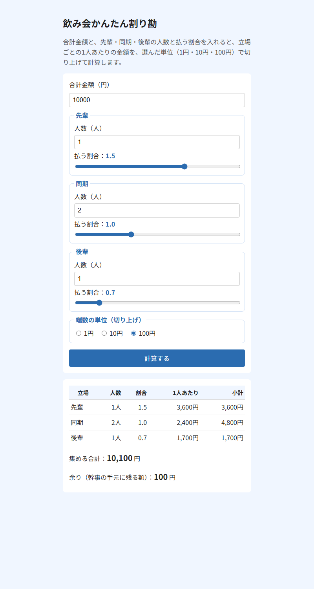

# 飲み会かんたん割り勘

合計金額と、先輩・同期・後輩の人数と払う割合を入れると、立場ごとの1人あたりの金額を計算する Web ページです。
「先輩は多めに、後輩は少なめに」といった飲み会の割り勘を、すぐに計算できます。



## できること

- 立場（先輩・同期・後輩）ごとに、払う割合を 0.5〜2.0 の間でスライダーで決められる
- 1人あたりの金額を、1円・10円・100円のどの単位で切り上げるか選べる
- 切り上げで多く集まった分を「余り（幹事の手元に残る額）」として表示する
- 一度「計算する」を押したあとは、入力を変えるとすぐに計算し直す

## 使い方

1. `index.html` をブラウザで開く
2. 合計金額（円）を入力する
3. 先輩・同期・後輩の人数を入力し、スライダーで払う割合を決める
4. 端数の単位（1円・10円・100円）を選ぶ
5. 「計算する」を押す

## 計算例

合計 10,000円、先輩1人（割合 1.5）・同期2人（1.0）・後輩1人（0.7）のとき

| 単位 | 先輩 | 同期 | 後輩 | 集める合計 | 余り |
|---|---|---|---|---|---|
| 100円 | 3,600円 | 2,400円 | 1,700円 | 10,100円 | 100円 |
| 1円 | 3,572円 | 2,381円 | 1,667円 | 10,001円 | 1円 |

## 入力のルール

- 人数の空欄は 0人として扱う。0人の立場は、金額が「-」になる
- 次のときは赤字でエラーを表示し、結果を「-」に戻す
  - 合計金額が空欄
  - 合計金額や人数が、マイナスまたは小数
  - 全員が 0人

## 計算の仕組み

### 1人あたりの金額

```text
1人あたり ＝ 合計 × その立場の割合 ÷（人数 × 割合 を全立場ぶん足したもの）
```

を計算し、選んだ単位で**切り上げ**ます。

上の計算例（100円単位）だと、人数 × 割合 の合計は 1×1.5 + 2×1.0 + 1×0.7 ＝ 4.2 なので、

- 先輩：10,000 × 1.5 ÷ 4.2 ＝ 約3,571円 → 3,600円
- 同期：10,000 × 1.0 ÷ 4.2 ＝ 約2,381円 → 2,400円
- 後輩：10,000 × 0.7 ÷ 4.2 ＝ 約1,667円 → 1,700円

### 割合を10倍した整数で計算する理由

コンピューターは小数の計算で、ほんの少しだけずれた答えを出すことがあります（例：`0.1 + 0.2` が `0.30000000000000004` になる）。
このずれのせいで、ぴったり割り切れるはずの金額が1円多く切り上げられてしまうことがあります。
そこで、割合を 10倍した整数（1.5 → 15）にしてから計算し、ずれが起きないようにしています。

### 余り

1人あたりを切り上げるので、集める合計は元の合計金額より少し多くなることがあります。
その差（集める合計 − 合計金額）が「余り」で、幹事の手元に残る額です。

## ファイル構成

| ファイル | 役割 |
|---|---|
| `index.html` | 画面 |
| `style.css` | 見た目 |
| `script.js` | 計算 |
| `images/` | README で使う画像 |

## 使った技術

- HTML / CSS / JavaScript（ライブラリは使っていません）
